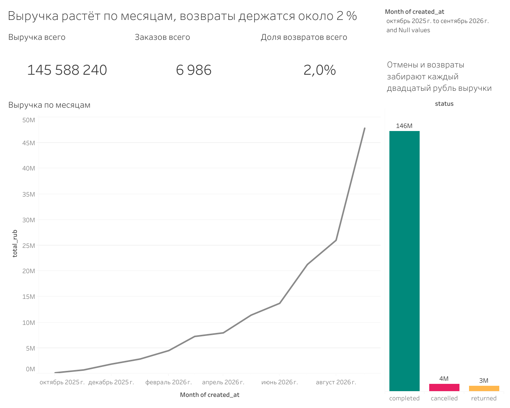

# 📊 Итоги магазина: интерактивный дашборд KPI и динамики

## 📌 О проекте
Дашборд «Итоги магазина», разработанный в Tableau, предназначен для интерактивного мониторинга ключевых показателей эффективности (KPI) интернет-магазина. Позволяет мгновенно оценивать общую выручку, количество заказов и долю возвратов, а также анализировать структуру заказов по статусам.

## 🔗 Ссылка на интерактивный дашборд
**[Открыть дашборд в Tableau Public](https://public.tableau.com/shared/65428M24B?:display_count=n&:origin=viz_share_link)**

## 🖼 Превью дашборда

## ⚡ Главная фишка: Интерактивность
Дашборд использует **Dashboard Actions** (Действия фильтрации). 
*   **Клик по статусу:** Нажатие на столбик в правой части (`completed`, `cancelled`, `returned`) перестраивает весь дашборд. Верхние KPI-карточки (Выручка, Заказы, Доля возвратов) и график динамики по месяцам мгновенно фильтруются под выбранный статус.
*   **Фильтр по периодам:** Ползунок в правом верхнем углу позволяет выбрать любой интервал дат, и все показатели автоматически пересчитываются.

## 💡 Ключевые выводы (Insights)
*   **Общая выручка:** За выбранный период (октябрь 2025 – сентябрь 2026) общая выручка составила **152,8 млн руб.**
*   **Здоровье бизнеса:** Количество заказов — **7 327**. Доля возвратов и отмен находится на низком уровне (**2,0%**), что означает потерю около каждого двадцатого рубля.
*   **Динамика:** Наблюдается устойчивый и ускоряющийся рост выручки по месяцам, с резким пиком в сентябре 2026 года.

## 🛠 Инструменты и методы
*   **Инструмент визуализации:** Tableau
*   **Интерактивность:** Настройка Filter Actions и параметров для управления периодами.
*   **Визуализация данных:** Построение KPI-карточек, линейных графиков и столбчатых диаграмм с кастомной цветовой палитрой.
*   **Работа с датами:** Настройка дискретных фильтров по датам.

## 📂 Структура репозитория
*   `data/` — исходные датасеты (CSV)
*   `dashboard/` — файл дашборда Tableau (.twbx)
*   `images/` — скриншоты для документации

## 🚀 Как посмотреть проект
1. Перейдите по **[ссылке на Tableau Public](https://public.tableau.com/shared/65428M24B?:display_count=n&:origin=viz_share_link)**, чтобы посмотреть интерактивную версию в браузере.
2. Либо скачайте файл `.twbx` из папки `dashboard` и откройте его в программе Tableau Public или Tableau Desktop.
